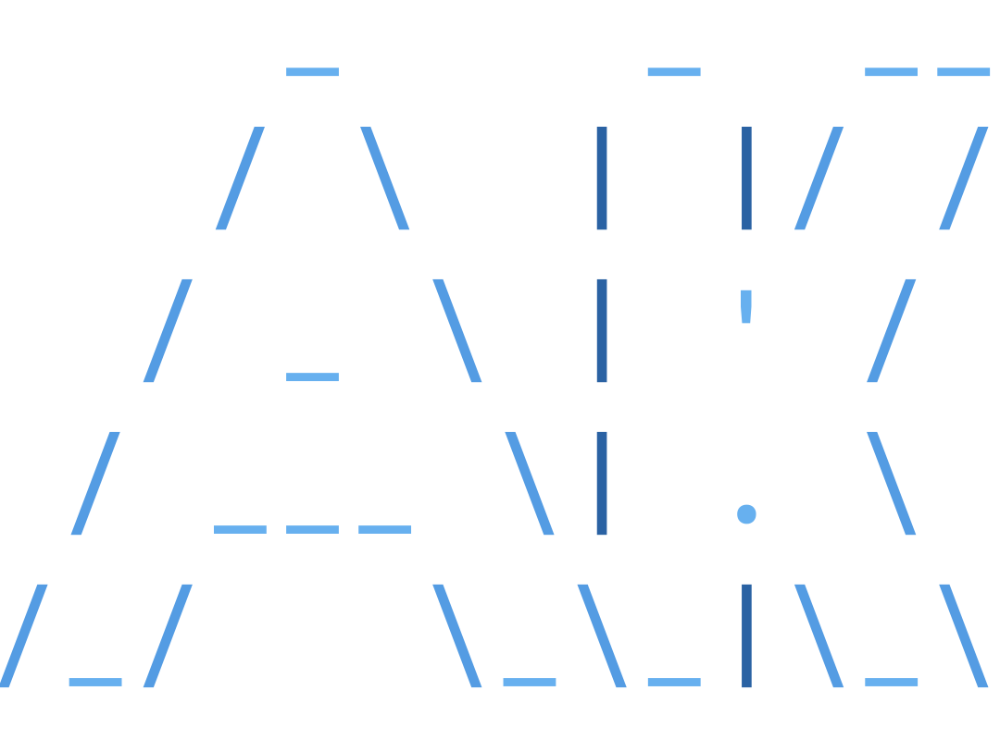

  

# Abhishek Krishna A M

`min resource, max output`

**Backend Developer · Systems Builder · Linux**

I build backends and daily-drive the tools I make. If something in my workflow is annoying, I build a replacement.

---

## Daily Uptime

| | |
|---|---|
| **OS** | Arch Linux — minimal, rolling release |
| **Editor** | Neovim — configured from scratch |
| **WM** | UWM — my own Wayland compositor |
| **Shell** | Bash + custom scripts for everything repetitive |
| **Backend** | APIs, auth systems, real-time features, storage pipelines |
| **Systems** | C, low-level tooling, protocol design |
| **Security** | Privacy-first configs, hardened networking |

---

## Projects

### Tools — Built and Use Daily

<table>
<tr>
<td width="50%" valign="top">

<b><a href="https://github.com/Abhishek-Krishna-A-M/UWM">UWM</a></b> — Wayland compositor written in C

 

Built on **wlroots** with a custom BSP layout engine.

**Highlights**
- BSP tree window management
- XDG Shell & Layer Shell support
- Multi-monitor hotplug handling
- Floating, Monocle & Tiling layouts
- Custom Wayland protocol (`zwp_uwm_bar_v1`)
- Per-window opacity & unfocus dimming
- Daily-driver compositor on Artix Linux

</td>

<td width="50%" valign="top">

<b><a href="https://github.com/Abhishek-Krishna-A-M/minimal-launcher">Minimal Launcher</a></b> — Terminal Android launcher

 

Designed for speed and minimal resource usage.

**Highlights**
- **15–20 MB RAM** idle
- Event-driven architecture
- Zero background services
- Instant fuzzy search
- Terminal-inspired interface
- Daily driver

</td>
</tr>
<tr>
<td width="50%" valign="top">

<b><a href="https://github.com/Abhishek-Krishna-A-M/quick_file_sender">QFS</a></b> — Terminal file transfer via QR code

 

**Highlights**
- Temporary HTTP server
- Automatic local IP detection
- QR-based transfer
- Folder compression
- Bi-directional transfer
- Zero installation required on receiver

</td>
<td width="50%" valign="top">

<b><a href="https://github.com/Abhishek-Krishna-A-M/gpad">gpad</a></b> — Git-backed CLI markdown notes

 

**Highlights**
- Git-backed synchronization
- Markdown rendering in terminal
- Single static binary
- Linux, macOS & Windows support
- Offline-first workflow

</td>
</tr>
</table>

---

### Shipped — Real Users

<table>
<tr>
<td width="50%" valign="top">

<b><a href="https://github.com/Abhishek-Krishna-A-M/Btechified">Btechified</a></b> — EdTech video platform

 

**Highlights**
- JWT authentication
- Google OAuth
- Supabase Row Level Security
- Cloudflare R2 storage
- Edge Functions
- Time-gated video delivery

</td>
<td width="50%" valign="top">

<b><a href="https://github.com/Abhishek-Krishna-A-M/Staffo">Staffo</a></b> — Real-time campus staff locator

 

**Highlights**
- Live staff availability
- Department-based search
- Admin dashboard
- Real-time updates
- Campus deployment

</td>
</tr>
<tr>
<td width="50%" valign="top">

<b><a href="https://github.com/Abhishek-Krishna-A-M/arts_app_2025">Arts App 2025</a></b> — Arts fest management

 

**Highlights**
- Live registrations
- Real-time results
- Role-based administration
- Production deployment during event day

</td>
<td width="50%" valign="top">

<b><a href="https://github.com/Abhishek-Krishna-A-M/questlytics">Questlytics</a></b> — AI exam paper analyzer

 

**Highlights**
- AI-powered paper analysis
- Topic frequency extraction
- Syllabus-aware predictions
- Historical paper processing

</td>
</tr>
</table>

---

## Experience

| Period | Role | Stack |
|--------|------|-------|
| **Nov 2026 – Present** | Backend Developer Intern · **Phottam.ai** | AWS Lambda · SQS · AWS Batch · CloudWatch · Serverless |
| **Mar 2026 – Present** | Founder & CTO · **[Webernyx](https://webernyx.in)** | Product Engineering · Node.js · React · PostgreSQL · Cloud |
| **May 2026 – Jun 2026** | Backend Developer Intern · Docwo · 🏆 Best Backend Developer | Node.js · Express · PostgreSQL · MinIO · Socket.io |
| **Nov 2025 – Mar 2026** | Backend Developer · Btechified | Node.js · Supabase · JWT · OAuth |
| **Jun 2025 – Jul 2025** | Backend Developer Intern · The Nexus Project | Node.js · Express · Supabase |

---

## Stack

### Languages & Systems

### Backend & Databases

### Frontend & Mobile

### DevOps, Cloud & Tooling

---

<picture>
  <source media="(prefers-color-scheme: dark)" srcset="https://github-readme-streak-stats-w194.vercel.app?user=Abhishek-Krishna-A-M&theme=github-dark-blue">
  <source media="(prefers-color-scheme: light)" srcset="https://github-readme-streak-stats-w194.vercel.app?user=Abhishek-Krishna-A-M&theme=meta-light">
  
</picture>

---

*Artix Linux · Neovim · a terminal for everything that can be a terminal*

